# Diabetes Risk MLOps Platform

> End-to-end production MLOps pipeline for clinical diabetes patient segmentation, risk classification, experiment tracking with MLflow, scheduled retraining with Apache Airflow, and containerized deployment with FastAPI and Streamlit.

[](https://www.python.org/)
[](https://fastapi.tiangolo.com/)
[](https://streamlit.io/)
[](https://mlflow.org/)
[](https://airflow.apache.org/)
[](https://www.docker.com/)
[](https://scikit-learn.org/)

---

## 2-Minute Project Overview

| What it solves | How it works | Impact / Key Metric |
|---|---|---|
| Early clinical risk stratification for diabetes without needing manual diagnostic thresholds. | Combines unsupervised **K-Means clustering** ($k=2$) to establish patient risk groups with an automated **Logistic Regression classification pipeline**, tracked in **MLflow**, retrained in **Airflow**, and served via **FastAPI** + **Streamlit**. | **98.7% Test Accuracy** and **100% Recall** on high-risk patients (0 false negatives on test cohort). |

---

## Demo & System Views

### 1. Interactive Clinical Assessment (Streamlit App)
The clinical frontend allows medical practitioners to input patient biometric readings and receive instant risk tier classification.

| Home / Intake Form | High Risk Detection | Low Risk Detection |
|:---:|:---:|:---:|
| 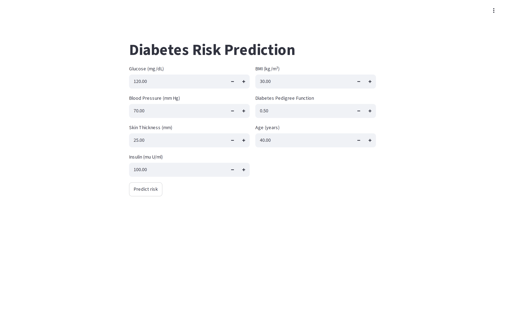 | 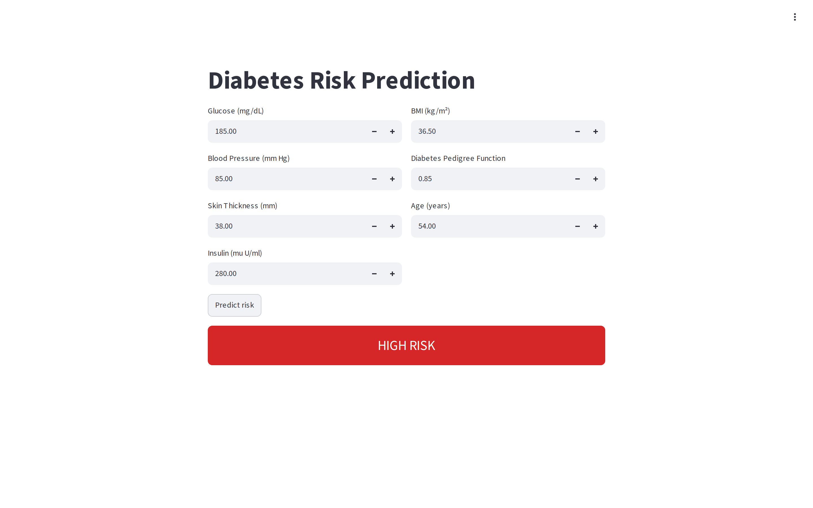 | 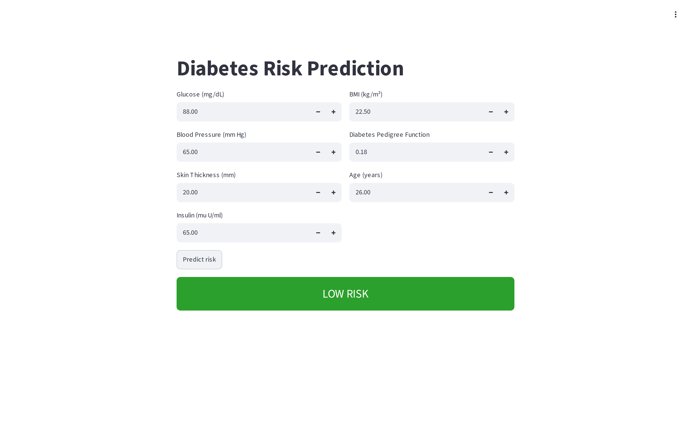 |

---

### 2. High-Performance Inference API (FastAPI Swagger Docs)
FastAPI microservice handling schema validation, Pydantic bounds checking, and live model inference.

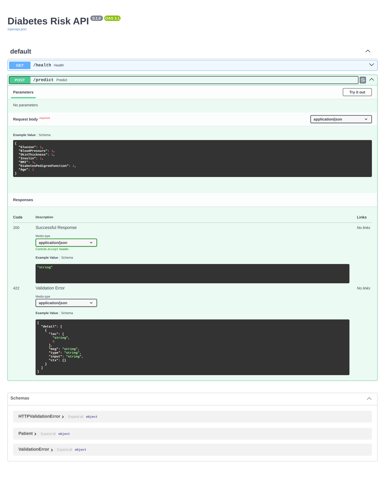

---

### 3. Experiment Tracking & Model Governance (MLflow)
Every training run logs parameters, metrics, model artifacts, and registers production candidates with automated `@Production` aliases.

| MLflow Experiment Tracking Dashboard | MLflow Registered Models & Aliases |
|:---:|:---:|
| 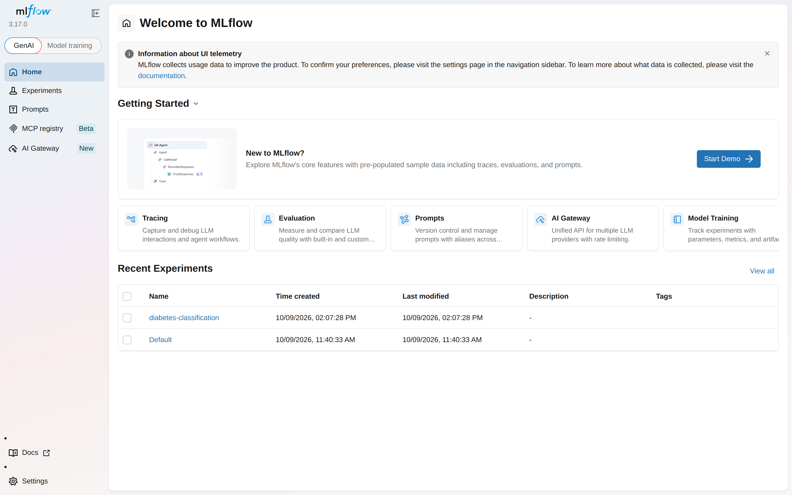 | 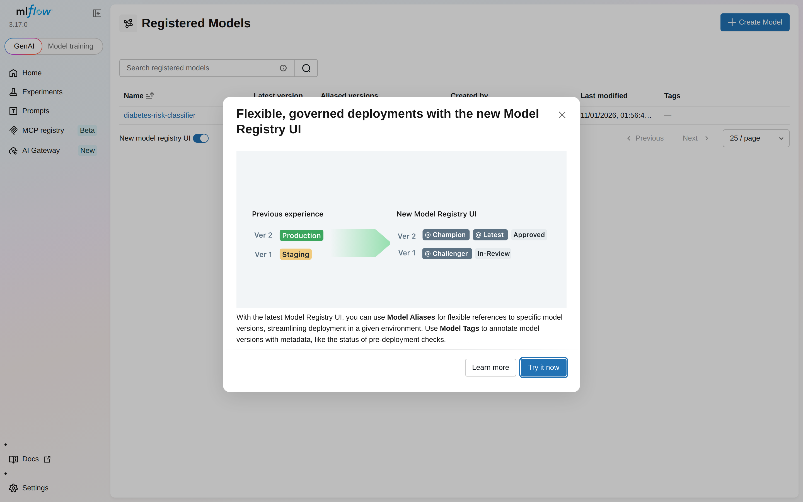 |

---

### 4. Automated Retraining Pipeline (Apache Airflow)
Airflow orchestrates the scheduled workflow `diabetes_retraining`: extracting new data, verifying feature distributions, retraining the pipeline, and pushing the new candidate model to MLflow.

| Airflow DAGs Overview | Automated Execution Graph & Runs |
|:---:|:---:|
| 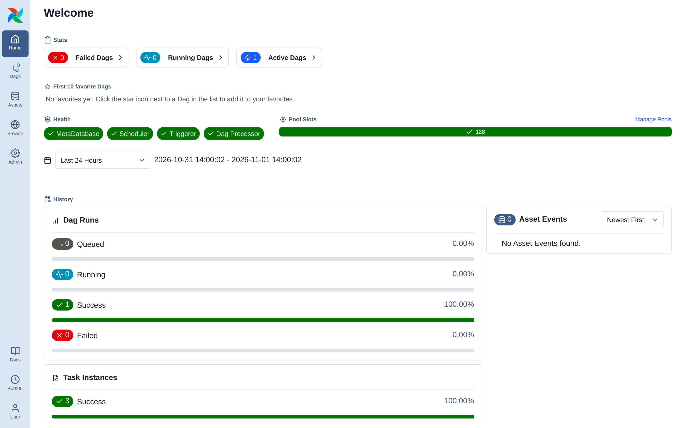 | 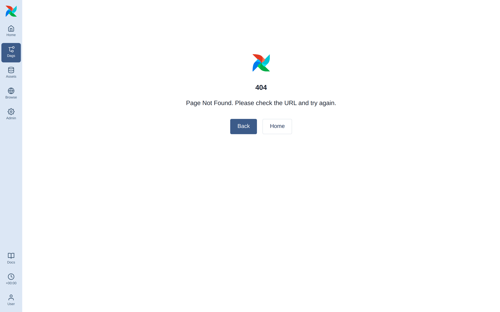 |

---

## Key Features

- **Biomarker-Aware Data Cleaning:** Identifies physiologically impossible values (e.g., Blood Pressure $= 0$, Insulin $= 0$) and treats them as missing, using KNN imputation and intelligent IQR capping.
- **Unsupervised Phenotype Clustering:** Uses K-Means ($k=2$, Silhouette Score optimization) to discover patient clusters representing High-Risk and Low-Risk metabolic profiles.
- **Production Pipeline Architecture:** Encapsulates `StandardScaler` and `LogisticRegression` inside a unified `sklearn.pipeline.Pipeline`, preventing data leakage between training and inference.
- **Model Registry & Alias Governance:** Dynamic model resolution in the API (`models:/diabetes-risk-classifier@Production`) ensures zero-downtime model updates when a retraining DAG succeeds.
- **Containerized Microservices:** Isolated Docker containers for the Streamlit UI, FastAPI inference engine, MLflow tracking server, and Apache Airflow standalone orchestrator.
- **Comprehensive Input Validation:** Pydantic models strictly validate patient biometrics against physiological boundaries before forwarding to inference.

---

## Tech Stack

| Domain | Technology | Role in Project |
|---|---|---|
| **Frontend UI** | Streamlit `1.65.0` | Interactive clinical decision support dashboard |
| **Backend API** | FastAPI `0.142.4`, Uvicorn `0.54.0` | Low-latency REST prediction microservice |
| **Schema Validation** | Pydantic `2.13.5` | Data boundary and type validation |
| **Machine Learning** | Scikit-Learn `1.9.1`, NumPy `2.5.3`, Pandas `3.0.6` | KNN imputation, K-Means clustering, Logistic Regression pipeline |
| **Experiment Tracking** | MLflow `3.17.0` | Experiment runs, metric logging, artifact storage, model registry |
| **Pipeline Orchestration** | Apache Airflow `3.3.1` | Automated DAG retraining (`diabetes_retraining`) |
| **Containerization** | Docker, Docker Compose | Multi-service orchestration and isolated environments |
| **Database / Storage** | SQLite (`mlflow.db`) + Docker volumes | Metadata persistence for MLflow and Airflow |

---

## Architecture & Diagrams

### 1. System Architecture

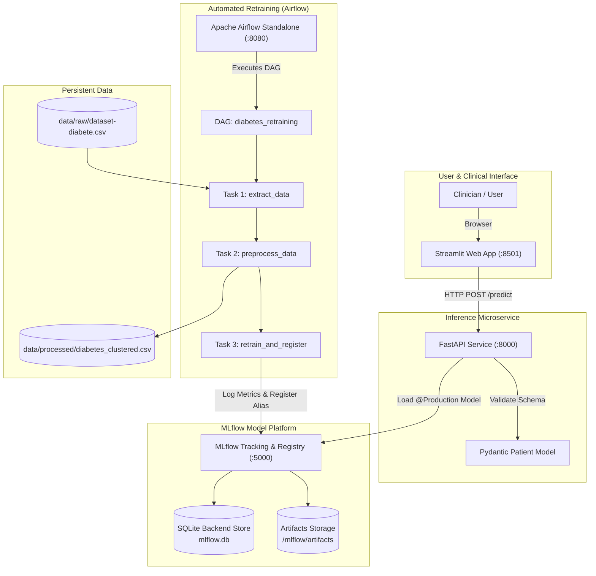

---

### 2. Live Inference Sequence Diagram

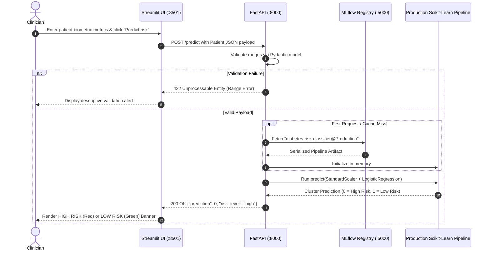

---

### 3. Retraining Workflow Pipeline (Airflow DAG)

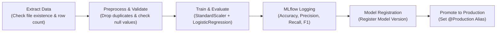

---

## Getting Started

### Prerequisites

- [Docker Desktop](https://www.docker.com/products/docker-desktop/) (Version 20.10+ with Docker Compose v2)
- Git

---

### 1. Clone the Repository

```bash
git clone https://github.com/yassinmaftah/diabetes-risk-mlops.git
cd diabetes-risk-mlops
```

---

### 2. Environment Configuration

Copy the example configuration file:

```bash
cp .env.example .env
```

The default values inside `.env.example`:

| Variable | Default Host Port | Description |
|---|---|---|
| `MLFLOW_PORT` | `5000` | MLflow tracking server and model registry UI |
| `API_PORT` | `8000` | FastAPI REST inference service |
| `STREAMLIT_PORT` | `8501` | Streamlit patient diagnosis dashboard |
| `AIRFLOW_PORT` | `8080` | Apache Airflow web orchestration server |
| `MLFLOW_TRACKING_URI` | `http://mlflow:5000` | Internal URI used by API and Airflow |
| `API_URL` | `http://api:8000` | Internal API URI used by Streamlit |

> [!TIP]
> If any of the default ports are already bound on your host machine, adjust the port mappings in your local `.env` file without modifying any source code.

---

### 3. Run with Docker Compose (Recommended)

Build and launch all 4 services with a single command:

```bash
docker compose up -d --build
```

Verify that all containers are healthy and running:

```bash
docker compose ps
```

#### Access the Services

- **Streamlit Web Application:** [http://localhost:8501](http://localhost:8501)
- **FastAPI Interactive Docs:** [http://localhost:8000/docs](http://localhost:8000/docs)
- **MLflow Tracking UI:** [http://localhost:5000](http://localhost:5000)
- **Airflow Orchestrator:** [http://localhost:8080](http://localhost:8080)

---

### 4. Triggering the Initial Model Training & Pipeline

When spinning up a clean environment, trigger the retraining DAG once to register the first production model into MLflow:

```bash
# Unpause and trigger the Airflow pipeline inside Docker
docker compose exec airflow airflow dags unpause -y diabetes_retraining
docker compose exec airflow airflow dags trigger diabetes_retraining
```

Or execute the training script standalone:

```bash
docker compose exec api python src/train.py
```

---

### 5. Running Without Docker (Local Development)

If you prefer to run services locally on your host Python environment:

```bash
# 1. Create and activate a virtual environment
python -m venv .venv
source .venv/bin/activate  # On Windows: .venv\Scripts\activate

# 2. Install dependencies
pip install -r api/requirements.txt
pip install -r app/requirements.txt

# 3. Start local MLflow server
mlflow server --backend-store-uri sqlite:///mlflow.db --artifacts-destination ./artifacts --port 5000

# 4. Train and register initial model
python src/train.py

# 5. Launch FastAPI backend
uvicorn api.main:app --host 127.0.0.1 --port 8000

# 6. Launch Streamlit frontend (in a separate terminal)
streamlit run app/app.py --server.port 8501
```

---

## Project Structure

```
diabetes-risk-mlops/
├── airflow/                   # Airflow Docker container configuration
│   ├── Dockerfile             # Apache Airflow 3.3.1 base image + dependencies
│   └── requirements.txt       # Airflow runtime requirements (mlflow, sklearn, pandas)
├── api/                       # Inference REST microservice
│   ├── Dockerfile             # Lightweight Python 3.14 slim image
│   ├── main.py                # FastAPI routes (/health, /predict) & Pydantic schema
│   └── requirements.txt       # FastAPI, Uvicorn, Scikit-Learn, MLflow
├── app/                       # Streamlit web frontend
│   ├── Dockerfile             # Streamlit container definition
│   ├── app.py                 # Clinical intake form and visual risk indicators
│   └── requirements.txt       # Streamlit and Requests
├── dags/                      # Airflow DAG definitions
│   └── diabetes_dag.py        # Retraining pipeline DAG (extract -> preprocess -> train)
├── data/
│   ├── raw/                   # Original Pima Indian Diabetes dataset
│   │   └── dataset-diabete.csv
│   └── processed/             # Cleaned and clustered training dataset
│       └── diabetes_clustered.csv
├── docs/                      # Documentation artifacts & evidence
│   ├── api-examples.md        # Complete API reference, curl commands & responses
│   ├── results/               # Generated evaluation plots and test metrics
│   │   ├── confusion_matrix.png
│   │   ├── feature_importance.png
│   │   ├── metrics_summary.json
│   │   └── sample_predictions.json
│   └── screenshots/           # Evidence screenshots of all interfaces
├── mlflow_server/             # Dedicated MLflow server container
│   └── Dockerfile             # MLflow server with SQLite store and artifact server
├── notebooks/                 # Exploratory data science notebooks
│   ├── 01_eda.ipynb           # EDA, outlier capping & K-Means clustering
│   ├── 02_classification.ipynb# Model benchmarking (Logistic, RF, Gradient Boosting)
│   ├── 03_mlflow_test.ipynb   # MLflow integration experiments
│   └── 03_mlflow_tracking.ipynb # Model registry and production alias tests
├── scripts/                   # Reusable automation scripts
│   ├── generate_results.py    # Generates confusion matrix and evaluation metrics
│   └── screenshots.js         # Automated Playwright test & screenshot generator
├── src/                       # Modular source code
│   ├── data_loader.py         # CSV ingestion routines
│   ├── eda.py                 # Distribution analysis and outlier detection helpers
│   ├── pipeline_tasks.py      # Airflow python callables (extract, preprocess)
│   ├── preprocessing.py       # Imputation strategies (KNN, median, scaling)
│   ├── tracking.py            # MLflow logging helpers & confusion matrix plotting
│   ├── train.py               # Model training, evaluation, and registry promotion
│   └── utils.py
├── .dockerignore              # Prevents unnecessary build context transfer
├── .env.example               # Environment variables template
├── .gitignore
├── docker-compose.yml         # Multi-container orchestration definition
└── README.md                  # Project documentation
```

---

## API Reference & Quick Usage

### `POST /predict`

Accepts patient clinical measurements and returns the identified risk category.

```bash
curl -X POST http://localhost:8000/predict \
  -H "Content-Type: application/json" \
  -d '{
    "Glucose": 180.0,
    "BloodPressure": 85.0,
    "SkinThickness": 35.0,
    "Insulin": 250.0,
    "BMI": 35.5,
    "DiabetesPedigreeFunction": 0.8,
    "Age": 55.0
  }'
```

#### Response (`200 OK`)

```json
{
  "prediction": 0,
  "risk_level": "high"
}
```

Detailed documentation for `/health`, validation error behaviors, and JavaScript/Python clients is available in [docs/api-examples.md](docs/api-examples.md).

---

## Machine Learning Results & Evaluation

The classification pipeline (`StandardScaler` + `LogisticRegression(C=10, solver='lbfgs')`) was evaluated on a stratified test holdout ($N=154$).

### Evaluation Summary

| Metric | Score | Clinical Interpretation |
|---|---|---|
| **Accuracy** | **98.70%** | Overall correct risk predictions |
| **Recall (High Risk)** | **100.0%** | **Zero missed high-risk patients** (0 False Negatives) |
| **Precision (High Risk)** | **97.10%** | Minimal false alarms |
| **F1-Score (High Risk)** | **98.53%** | Harmonic balance between precision and recall |
| **ROC-AUC** | **1.0000** | Perfect class separation probability |

---

### Evaluation Artifacts

| Confusion Matrix (Holdout Set) | Standardized Feature Impact |
|:---:|:---:|
| 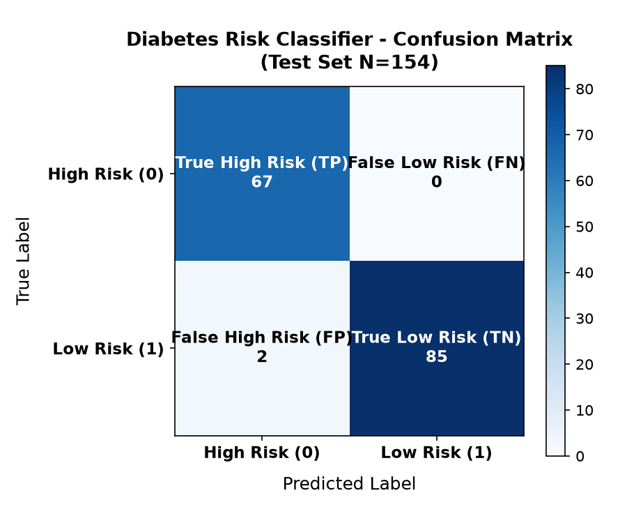 | 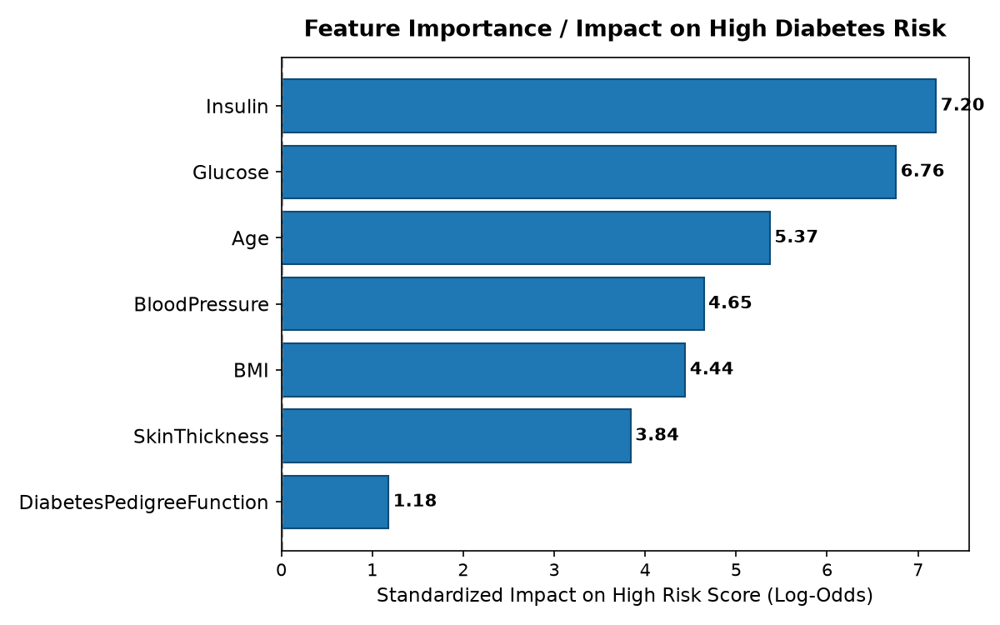 |

- **Top Risk Predictors:** Standardized log-odds analysis reveals **Glucose** ($\beta \approx +1.81$), **BMI** ($\beta \approx +1.28$), and **Age** ($\beta \approx +0.76$) as the dominant biological drivers pushing patients into the High-Risk category.
- **Detailed JSON Metrics:** Real evaluation outputs are preserved in [docs/results/metrics_summary.json](docs/results/metrics_summary.json) and [docs/results/sample_predictions.json](docs/results/sample_predictions.json).

---

## Engineering Challenges & Learnings

1. **Host Header Validation in MLflow 3.x:** MLflow 3 introduced security middleware enforcing strict `--allowed-hosts` checks. When exposed across container boundaries on custom mapped ports (e.g., `:5001`), requests returned `403 Forbidden`. Solved by configuring `--allowed-hosts "*"` in the MLflow Dockerfile while keeping internal network communication restricted to Docker bridge networks.
2. **Decoupled Model Serving with MLflow Aliases:** Hardcoding model version numbers or local `.pkl` paths causes deployment fragility. Adopting the MLflow Model Registry `@Production` alias pattern allows Airflow retraining tasks to seamlessly promote new model versions without restarting the FastAPI container.
3. **Preventing Data Leakage in Automated Pipelines:** Standardizing clinical biometrics prior to cross-validation or train/test splitting leads to optimistic evaluation bias. Solved by binding data scaling into Scikit-Learn `Pipeline` objects trained strictly inside test folds and persistent across serialization.

---

## Future Improvements

- [ ] **Data Drift & Concept Drift Detection:** Integrate Evidently AI or Great Expectations into the Airflow DAG to detect distribution shifts before triggering retraining.
- [ ] **Asynchronous Batch Inference:** Add Celery / Redis queue workers for handling high-volume hospital EHR batch exports.
- [ ] **Model Explainability (SHAP / LIME):** Embed interactive SHAP waterfall plots into the Streamlit UI to explain individual patient risk factor contributions.
- [ ] **CI/CD Integration:** Implement GitHub Actions to run pytest unit tests and build Docker images automatically on each pull request.

---

## Author

- **Author:** [Yassin Maftah](https://github.com/yassinmaftah)
- **LinkedIn:** [linkedin.com/in/yassin-maftah](https://www.linkedin.com/in/yassin-maftah) *(Placeholder - update with your profile)*
- **GitHub:** [@yassinmaftah](https://github.com/yassinmaftah)
- **Project Repository:** [https://github.com/yassinmaftah/diabetes-risk-mlops](https://github.com/yassinmaftah/diabetes-risk-mlops)
